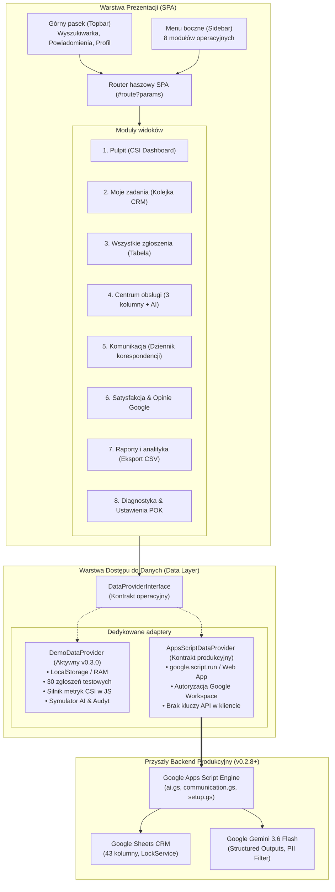

# ELWOZ ECO SmartCare Manager v0.3.0 – Architektura Systemu

**Wersja:** 0.3.0 (Demo Prototype)  
**Projekt:** Studencki prototyp wdrożeniowy – Uniwersytet WSB Merito w Gdańsku  
**Przedsiębiorstwo:** ELWOZ ECO Sp. z o.o. (Rejon Kartuzy)  
**Status integracji:** Etap 1 – Kompletna aplikacja demonstracyjna (izolacja przed integracją z v0.2.8)  

---

## 1. Wprowadzenie i cele architektoniczne

Aplikacja **ELWOZ ECO SmartCare Manager v0.3.0** została zaprojektowana jako nowoczesny, wyspecjalizowany interfejs webowy typu Single Page Application (SPA) dla pracowników biura obsługi mieszkańców (POK Kartuzy). Zastępuje ona bezpośrednią pracę w arkuszu kalkulacyjnym Google Sheets, podnosząc ergonomię, skracając czas pierwszej reakcji na zgłoszenia oraz zapewniając automatyczne wsparcie analityczne sztucznej inteligencji (Gemini 3.6 Flash) w standardzie **Human-in-the-Loop**.

### Główne filary architektoniczne:
1. **Zero-Framework Overhead:** Czysty HTML5, CSS3 oraz JavaScript (ES Modules). Brak ciężkich frameworków (React, Vue, Angular) eliminujący potrzebę kompilacji i instalacji dodatkowych narzędzi przez pracowników.
2. **Ścisłe rozdzielenie UI od dostępu do danych (Wzorzec DataProvider):** Cała warstwa prezentacji komunikuje się z danymi wyłącznie przez interfejs `DataProviderInterface`.
3. **Kompatybilność z 43 kolumnami CRM:** Pełne odzwierciedlenie modelu danych bazy Google Sheets z wersji v0.2.7/v0.2.8.
4. **Bezpieczeństwo i ochrona prywatności (Privacy-by-Design):** Klucze API nigdy nie trafiają do kodu przeglądarki; dane osobowe są anonimizowane przed modelem AI; operacje demonstracyjne są jednoznacznie odizolowane.
5. **Działanie hybrydowe (Offline & Online):** Biblioteki Chart.js oraz Lucide Icons są zlokalizowane lokalnie (`manager/vendor/`) z automatycznym fallbackiem CDN.

---

## 2. Diagram architektury systemu



---

## 3. Struktura katalogów i plików modułu Manager

```text
manager/
├── index.html                  # Główny plik wejściowy aplikacji SPA
├── css/
│   ├── main.css                # Zmienne CSS, reset, układ bazowy, topbar, sidebar
│   ├── components.css          # Przyciski, kontrolki, odznaki, tabele, modale, toasty
│   ├── dashboard.css           # 16 kafelków KPI CSI, siatka wykresów, sekcja Top 5
│   ├── detail.css              # Trzykolumnowy pulpit zgłoszenia, kreator wiadomości
│   └── responsive.css          # Dedykowane reguły dla 1366x768 i 1920x1080
├── js/
│   ├── app.js                  # Koordynator aplikacji, rejestracja routera, start
│   ├── components/
│   │   ├── modal.js            # Dostępne okna dialogowe (WCAG)
│   │   ├── sidebar.js          # Zwijane menu boczne (230px / 68px) z licznikami
│   │   ├── toast.js            # Powiadomienia operacyjne
│   │   └── topbar.js           # Wyszukiwarka globalna, powiadomienia, przełącznik pracownika
│   ├── data/
│   │   ├── dataProvider.js     # Interfejs abstrakcyjny DataProviderInterface
│   │   ├── demoProvider.js     # Implementacja DemoDataProvider (localStorage + analityka)
│   │   ├── gasProvider.js      # Kontrakt i adapter AppsScriptDataProvider
│   │   └── initialDataset.js   # 30 syntetycznych zgłoszeń testowych (Kaszuby/Kartuzy)
│   └── views/
│       ├── commsView.js        # Moduł 4: Komunikacja (Dziennik korespondencji)
│       ├── csatView.js         # Moduł 5: Satysfakcja & Reputacja Google
│       ├── dashboardView.js    # Moduł 1: Pulpit Customer Service Intelligence
│       ├── detailView.js       # Centrum obsługi pojedynczego zgłoszenia (3 panele)
│       ├── diagnosticsView.js  # Moduł 7: Diagnostyka i symulator awarii
│       ├── reportsView.js      # Moduł 6: Raporty i analityka (Eksport CSV)
│       ├── settingsView.js     # Moduł 8: Ustawienia, pracownicy i reset demo
│       ├── tasksView.js        # Moduł 2: Moje zadania (Kolejka CRM)
│       └── ticketsView.js      # Moduł 3: Wszystkie zgłoszenia (Tabela z filtrami)
├── tests/
│   ├── runTests.js             # Zautomatyzowany skrypt testowy Node.js (30 testów)
│   ├── server.js               # Lokalny serwer statyczny HTTP
│   └── captureScreenshots.js   # Zautomatyzowany zrzut ekranów z Chrome Headless
└── vendor/
    ├── chart.umd.js            # Chart.js v4.4.7 (lokalna kopia)
    └── lucide.min.js           # Lucide Icons (lokalna kopia)
```

---

## 4. Model danych – 43 Kolumny CRM

Aplikacja operuje na kompletnym zestawie 43 kolumn arkusza Google Sheets wypracowanym w wersji v0.2.7:

1. **Sygnatura czasowa** (`timestamp`)
2. **Rodzaj zgłoszenia** (`type`)
3. **Rodzaj odpadów** (`fraction`)
4. **Miejscowość** (`city`)
5. **Ulica lub lokalizacja** (`street`)
6. **Numer posesji lub identyfikator miejsca** (`houseNumber`)
7. **Data wystąpienia problemu** (`incidentDate`)
8. **Opis zgłoszenia** (`description`)
9. **Imię i nazwisko** (`applicantName`)
10. **Numer telefonu** (`applicantPhone`)
11. **Adres e-mail** (`applicantEmail`)
12. **Prośba o kontakt ze strony pracownika** (`contactRequest`)
13. **ID Zgłoszenia** (`id`, format `ELW-2026-XXXX`)
14. **Status** (`status`: Nowe, Do weryfikacji, W realizacji, Oczekuje na informacje, Rozwiązane)
15. **Priorytet** (`priority`: PILNY, WYSOKI, STANDARDOWY, NISKI)
16. **Sugerowany priorytet AI** (`suggestedPriority`)
17. **Uzasadnienie priorytetu AI** (`priorityRationale`)
18. **Stan analizy AI** (`aiState`: Przeanalizowano, Wymaga weryfikacji, Błąd, Brak)
19. **Lokalna kontrola danych** (`localValidation`)
20. **Wykryte sprzeczności AI** (`contradictions`)
21. **Pracownik odpowiedzialny** (`assignee`)
22. **Następne działanie** (`nextAction`)
23. **Strona odpowiedzialna** (`responsibleSide`: Przedsiębiorstwo / Mieszkaniec)
24. **Termin następnego działania** (`nextActionDeadline`)
25. **Termin SLA 1. reakcji** (`slaDeadline`)
26. **Przekroczenie SLA** (`slaOverdue`: TAK / NIE)
27. **Notatka pracownika** (`employeeNote`)
28. **Data potwierdzenia przyjęcia** (`receiptConfirmedDate`)
29. **Data pierwszego kontaktu** (`firstContactDate`)
30. **Data ostatniego kontaktu** (`lastContactDate`)
31. **Data rozwiązania** (`resolvedDate`)
32. **Sposób rozwiązania sprawy** (`resolutionMethod`)
33. **Wynik kontaktu z mieszkańcem** (`contactResult`)
34. **Ocena satysfakcji (1-5)** (`satisfactionScore`)
35. **Uwagi mieszkańca** (`citizenFeedback`)
36. **Prośba o opinię wysłana** (`reviewInviteSent`: TAK / NIE)
37. **Data wysłania prośby o opinię** (`reviewInviteDate`)
38. **Kategoria AI** (`aiCategory`)
39. **Streszczenie AI** (`aiSummary`)
40. **Brakujące informacje AI** (`aiMissingInfo`)
41. **Sugerowane działanie AI** (`aiSuggestedAction`)
42. **Rekomendowany kolejny krok AI** (`aiRecommendedStep`)
43. **Proponowana odpowiedź AI** (`aiDraftReply`)

---

## 5. Dostępność i ergonomia (WCAG 2.2 AA)

- **Kontrast:** Wszystkie teksty i elementy aktywne spełniają minimalny kontrast 4.5:1 (tekst standardowy) oraz 3:1 (duże nagłówki i ikony funkcjonalne).
- **Czytelność:** Bazowy rozmiar fontu to 14 px, dane tabelaryczne 13 px, główne nagłówki 24–28 px.
- **Wysokość wiersza tabeli:** 44–48 px, zapewniająca precyzyjne operowanie kursorem.
- **Odpowiedź na kliknięcie:** Pełna obsługa klawiatury (Enter, Esc w modalach, focus states) oraz natychmiastowe wizualne sprzężenie zwrotne (toasty i wskaźniki postępu).

---

## 6. Architektura Multi-Provider AI oraz Pre-Send Guardrail CX/PR

W wersji v0.3.0 wprowadzono rozszerzalną architekturę modułu sztucznej inteligencji oraz dwuetapowy łańcuch kontroli jakości korespondencji z mieszkańcami:

1. **Wielodostawczość (Multi-Provider AI):**
   - **Google Gemini (Aktywny dostawca):** Modele Gemini 2.5 Flash / Gemini 1.5 Flash zintegrowane w backendzie Apps Script ze Structured Outputs.
   - **OpenAI (ChatGPT) & Anthropic (Claude):** Architektura przygotowana pod rozszerzenie w wersji v0.4.0 (oznaczone jako planowane integracje).
   - **Polityka zarządzania kluczami API:** Klucze API pod żadnym pozorem nie są przechowywane w kodzie frontendowym, plikach cookies ani `localStorage`. Klucz centralny administrator konfiguruje po stronie serwera (`ScriptProperties`). W trybie connected przełącznik indywidualnych kluczy jest nieaktywny; zapis organizacyjnych ustawień nie modyfikuje konfiguracji Gemini.
   - **Edukacja licencyjna:** System jednoznacznie przypomina, że abonamenty konsumenckie (ChatGPT Plus, Gemini Advanced) nie zapewniają dostępu do API, który wymaga osobnego konta w konsoli programistycznej Google AI Studio lub OpenAI Platform.

2. **Dwuetapowa kontrola jakości (CX/PR Quality Chain):**
   - **Etap 1: Asystent redakcyjny AI (`simulateCxAiRefine` / Backend Prompt):** Przekształca surowe notatki w uprzejme, empatyczne wiadomości, usuwając wulgaryzmy, oskarżenia klienta oraz wzmianki o postępowaniach dyscyplinarnych wobec kierowców. W przypadku braku faktów (Scenariusz B) odmawia odpowiedzi i żąda ustaleń.
   - **Etap 2: Strażnik wysyłki (Pre-Send Guardrail – `evaluateMessageQuality`):** Niezależny walidator działający w momencie zatwierdzenia wysyłki. Blokuje próby wysłania wiadomości niespełniających standardów z oficjalnym komunikatem:
     *„Wiadomość nie spełnia standardów komunikacji z mieszkańcem. Popraw treść lub skorzystaj z asystenta AI.”*

